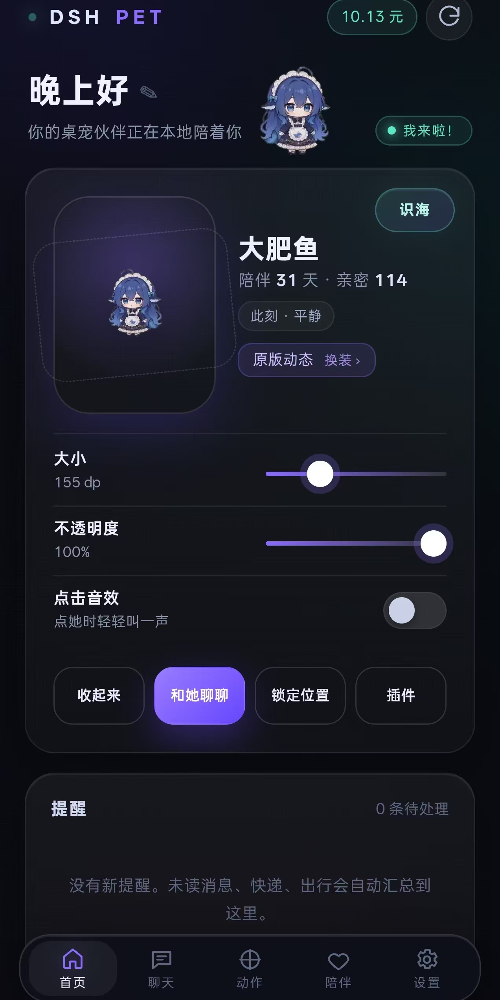

# DSH 桌宠

一个跑在 Android 手机上的桌面宠物。她会浮在屏幕边上，能拖动、能缩小藏起来；点她会有反应，跟她说话她会回。处得久了，她会记得你说过的事。



项目从 2026 年 10 月底开始写，一路加到 2.6.2。实现方式是原生 Java 加一个 WebView 前端，界面全是 HTML/CSS/JS，聊天、记忆、权限这些能力放在 Java 层。仓库里是 2.6.2 的完整源码。

## 她能做的事

**桌宠**

- 两种形象：Live2D 和逐帧动画，可以换肤。
- 能拖动、缩放、调透明度、锁位置；点她会有动作和音效。
- 动作页可以单独预览动作，陪伴页能看到她主动说过的话和情绪记录。

**聊天**

- 走 OpenAI 兼容接口，DeepSeek、通义、自建网关都行，流式输出，一句一句往外蹦。
- 能发图片，但要另外配一个支持视觉的模型。
- 能发文件，TXT、MD、CSV、JSON、DOCX、XLSX、PPTX 这些会先把正文抽出来再交给模型。PDF 和旧版 DOC 不解析。
- 回复太长或者沾了代码，会收成一张可展开的文档卡片，能复制，也能导出成文件。

**记忆**

- 你说"记住这件事"，她当场就存，并置顶。
- 平时聊天里她也会自己提炼，但引用的必须是你原话里真有的句子，对不上就不收。
- 记忆有置信度、有效期和取代关系，攒到 600 条会自动裁剪。识海页面把这些记忆画成一张能转的星图。

**日记和性格**

- 日记不是每天交作业。她觉得这天有东西可写才写，也可以不写。
- 性格有个固定底色（关系、原型、语调），表达层面每天慢慢变一点，最快七天动一次，改完要过长度和禁用词两道检查。

**QQ 和 AstrBot**

- 接上 NapCat/OneBot 以后，QQ 私聊和桌宠聊天共用同一个大脑、同一份记忆；群聊单独存，不会进你的私人记忆。
- AstrBot 可以接管思考。打开手机工具后，她还能反过来操作手机：读屏、开应用、点文字、滑动。每个动作都要你在桌宠前台点一下确认才算数，群聊里不触发。

**其他零碎**

- 阅读书架，支持 TXT/EPUB/PDF，会记进度和笔记。
- 提醒、待办、专注计时、到达某地的位置提醒。
- 记账、通知摘要、应用使用统计、音乐歌词、广告跳过。
- 插件支持配置和 JS，也可以让 AI 直接写 Java，编译成 DEX 装进应用里跑。

## 先说清楚几件事

- 仓库里没有任何 API Key。第一次启动要去"设置 → 智能核心"填地址、Key 和模型名，不填的话很多功能用不了。
- QQ 不是内置的。要自己跑一个 NapCat，把 WebSocket 地址填进来。两台设备尽量在同一个局域网，跨网络请走内网穿透或 VPN，别把端口直接暴露到公网。
- 记忆、日记、聊天、书架全部存在手机私有目录 `files/S-G`，不上云。设置里有整包导出和导入，换手机靠它。
- 屏幕观察、广告跳过、自动点按这些功能依赖无障碍权限，通知摘要依赖通知读取权限。这些权限能看到的内容不少，给不给、给哪几项，你自己判断。
- 只支持 Android 9 及以上。主要在一台真机上验证过，不同厂商的省电策略和自启动限制会影响后台存活。
- 工程是手工打包的，没有 Gradle。当初没搭工程，后来功能多了也懒得迁了，`build.ps1` 直接调 aapt2、javac、R8、D8 和 NDK。

## 装上试试

1. 成品在 [Releases](../../releases) 里，直接下 `dsh-pet-v2.6.2-v108.apk`（189MB）装上就行。想自己编，步骤写在 [docs/构建.md](docs/构建.md)。
2. 装好后先给悬浮窗权限，再点首页的"放出来"，她才会出现在桌面上。
3. 去设置里填模型接口。OpenAI 兼容地址一般形如 `https://api.xxx.com/v1`，模型名按服务商写的填。
4. 首页会提示还差哪几项设置，点进去逐项补。

详细一点的步骤写在 [docs/上手.md](docs/上手.md)，包括 QQ 和 AstrBot 怎么接。

## 自己编译

需要 JDK 17、Android SDK（build-tools 36.0.0、platform android-36、NDK 28.2.13676358）。Live2D 的 Core 是闭源的，仓库里没有，要自己去官网下。

```powershell
$env:ANDROID_SDK_ROOT = "D:\android-sdk"
powershell -ExecutionPolicy Bypass -File .\build.ps1 `
  -KeystorePath .\my.keystore -KeystorePass "你的密码"
```

第一次编译大概率会卡在路径、签名或者 Live2D 上。常见坑都写在 [docs/构建.md](docs/构建.md) 里了。

## 目录

```
dsh-pet/
├─ app/
│  ├─ src/main/java/com/dshpet/android/   # 应用主体，116 个类
│  ├─ src/main/java/com/live2d/           # Cubism Java 框架
│  ├─ src/main/assets/ui/                 # WebView 前端
│  ├─ src/main/assets/webp/               # 逐帧形象，107 张
│  ├─ src/main/cpp/dshcore.cpp            # 签名校验、前端解密的原生部分
│  ├─ src/main/res/                       # 图标、音效、无障碍配置
│  └─ libs/                               # ECJ、R8、Android API 编译桩
├─ build.ps1                              # 打包脚本
└─ docs/                                  # 使用、架构、构建、FAQ
```

一次聊天在代码里怎么走、哪些文件存在哪，写在 [docs/架构.md](docs/架构.md)。

## 许可

代码用 MIT，见 [LICENSE](LICENSE)。

有几样东西不在 MIT 范围内，用之前请读 [NOTICE.md](NOTICE.md)：

- Live2D Cubism Core 是 Live2D 公司的闭源组件，仓库不含这份文件，使用要遵守他们的协议。
- `app/src/main/assets/webp` 里的角色形象素材由作者保留权利，转发或商用前请先问一声。
- 前端用到 three.js、3d-force-graph 等开源库，各自的许可放在 `app/src/main/assets/licenses/`。

## 最后

这个项目是一个人断断续续写的，不少地方是"能跑就行"。issue 和 PR 都欢迎，但别指望我回得很快。
</content>
